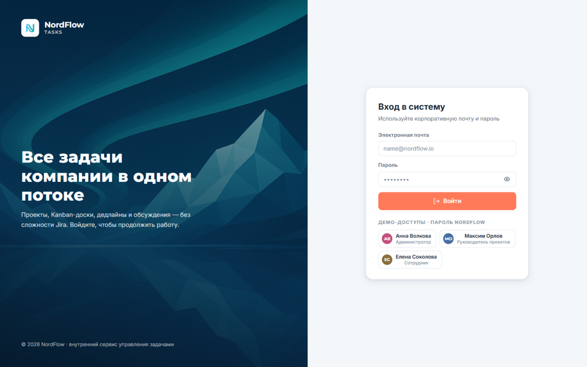
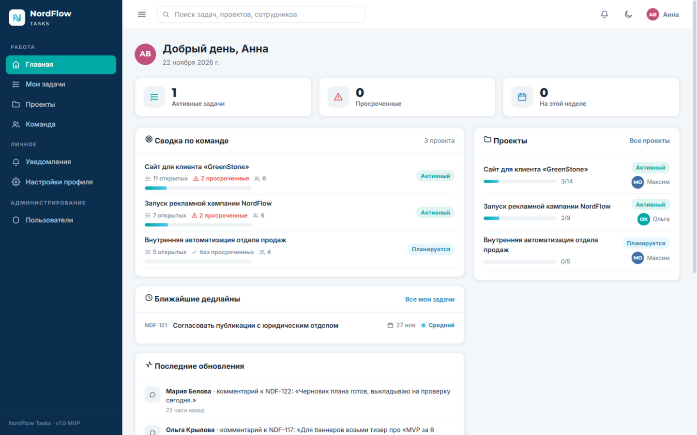
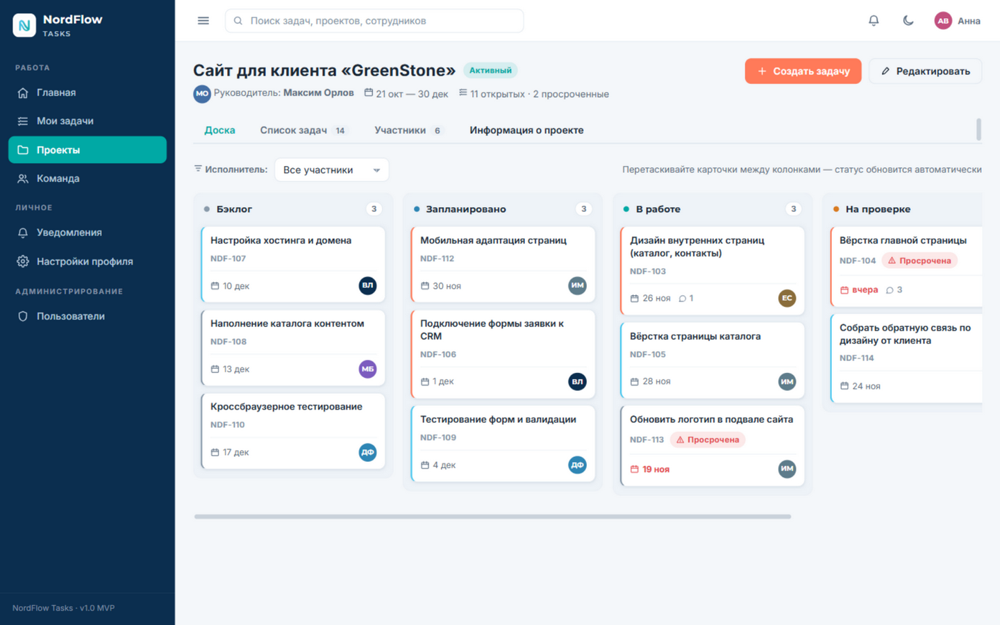
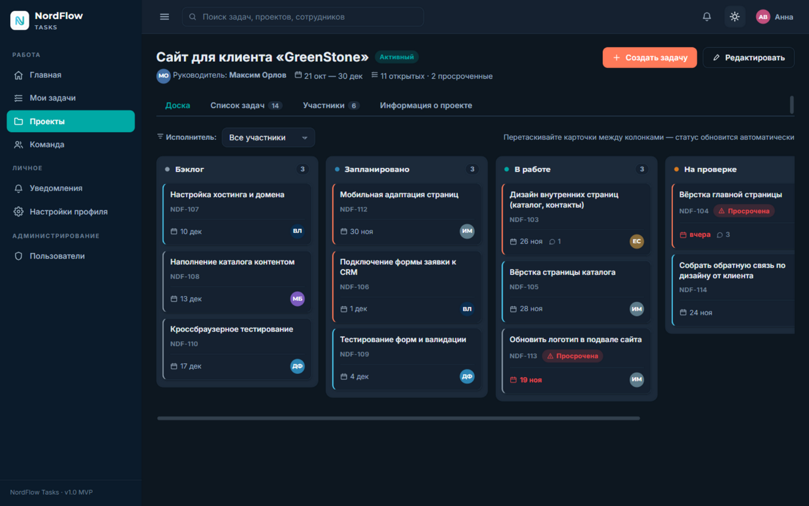

# NordFlow Tasks

Внутренний трекер проектов и задач компании NordFlow — веб-версия (HTML/CSS/JS), MVP по техническому заданию.

## Скриншоты






## Задача

Руководителю нужен порядок в задачах команды: проекты, Kanban-доски, дедлайны и обсуждения — без сложности Jira. Адаптивное веб-приложение, данные хранятся в localStorage.

## Функции

- Роли: админ, руководитель проектов, сотрудник
- Авторизация
- Kanban-доска с 5 колонками и drag-n-drop
- Задачи с приоритетами и тегами
- Комментарии и уведомления
- Глобальный поиск
- Тёмная тема
- Адаптивная вёрстка

Демо-данные: 8 сотрудников, 3 проекта, 28 задач. Демо-доступы показаны на экране входа (пароль: `nordflow`).

## Как запустить

Открыть `index.html` напрямую или через локальный сервер:

```bash
python -m http.server 8080
# или
npx serve .
```

Также есть Dockerfile.

## Стек

- HTML/CSS/JS (ванильный, без фреймворков)
- localStorage для хранения данных
- Docker

Структура: `css/styles.css`, `js/util.js`, `store.js`, `ui.js`, `views-*.js`, `app.js`.
